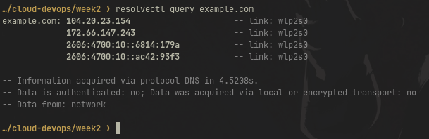
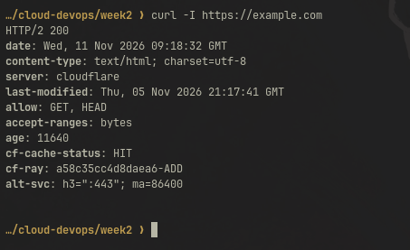

# Week 2 Lab: Networking & IAM Fundamentals

## Task 1: Network Information

```text
$ ip -4 -br addr
lo               UNKNOWN        127.0.0.1/8
wlp2s0           UP             172.24.193.188/24

$ ip route | grep default
default via 172.24.193.132 dev wlp2s0 proto dhcp src 172.24.193.188
```

| Item | Value |
|---|---|
| Operating system | Linux |
| Local IPv4 address | 172.24.193.188 |
| Default gateway | 172.24.193.132 |
| Private or public | Private (within 172.16.0.0/12) |

## Task 2: Subnetting 10.0.0.0/24

### Calculations

- /24 has 32 − 24 = 8 host bits, so 2^8 = 256 addresses
- 4 subnets need 2 borrowed bits (2^2 = 4), so the new prefix is /26
- Addresses per subnet: 2^(32 − 26) = 64
- Mask: 255.255.255.192, block size 256 − 192 = 64
- Conventional usable hosts: 64 − 2 = 62
- AWS usable hosts: 64 − 5 = 59 (AWS reserves the network address, .1 router, .2 DNS, .3 future use, and the broadcast address)

### Results

| # | CIDR | Network | Full range | Usable range | Broadcast | AWS usable |
|---|---|---|---|---|---|---|
| 1 | 10.0.0.0/26 | 10.0.0.0 | 10.0.0.0 to 10.0.0.63 | 10.0.0.1 to 10.0.0.62 | 10.0.0.63 | 59 |
| 2 | 10.0.0.64/26 | 10.0.0.64 | 10.0.0.64 to 10.0.0.127 | 10.0.0.65 to 10.0.0.126 | 10.0.0.127 | 59 |
| 3 | 10.0.0.128/26 | 10.0.0.128 | 10.0.0.128 to 10.0.0.191 | 10.0.0.129 to 10.0.0.190 | 10.0.0.191 | 59 |
| 4 | 10.0.0.192/26 | 10.0.0.192 | 10.0.0.192 to 10.0.0.255 | 10.0.0.193 to 10.0.0.254 | 10.0.0.255 | 59 |

## Task 3: DNS Resolution

Tool used: `resolvectl query` (nslookup not installed)

```text
$ resolvectl query example.com
example.com: 172.66.147.243
             104.20.23.154
             2606:4700:10::ac42:93f3
             2606:4700:10::6814:179a
```

| Item | Result |
|---|---|
| Domain tested | example.com |
| Resolution succeeded | Yes |
| IP addresses | 104.20.23.154, 172.66.147.243 |

**What DNS does:** It translates domain names into IP addresses so computers can find and connect to each other.



## Task 4: HTTPS Website

```text
$ curl -I https://example.com
HTTP/2 200
content-type: text/html; charset=utf-8
server: cloudflare
```

| Item | Result |
|---|---|
| Website loaded | Yes |
| Status code | 200 OK |

**What HTTPS adds to HTTP:** Encryption, data integrity, and server authentication via TLS certificates.

**Why DNS alone doesn't guarantee a site loads:** DNS only provides the IP address. The network path, the TCP connection, the TLS handshake, and the server's response can all still fail.



## Task 5: HTTP Status Codes

| Status code | Meaning | Example situation |
|---|---|---|
| 200 | OK | Page loads normally |
| 301 | Moved Permanently | http:// redirects to https:// |
| 403 | Forbidden | Accessing a private S3 object without permission |
| 404 | Not Found | Visiting a page that doesn't exist |
| 500 | Internal Server Error | Backend application crashes |

**DNS failure vs. timeout vs. TLS error vs. HTTP error:**

- **DNS failure:** The domain name can't be resolved to an IP address.
- **Connection timeout:** The IP is known, but the server doesn't respond (firewall, server down, routing).
- **TLS certificate error:** The connection works, but the certificate is invalid, expired, or for the wrong domain.
- **HTTP error response:** The server responds, but with an error status like 404 or 500.

## Task 6: Least-Privilege IAM Policy

See [s3-read-policy.json](s3-read-policy.json).

```json
{
  "Version": "2012-10-17",
  "Statement": [
    {
      "Effect": "Allow",
      "Action": "s3:GetObject",
      "Resource": "arn:aws:s3:::example-bucket/*"
    }
  ]
}
```

**Which field specifies the permitted action?** `Action`

**Which field specifies the resources?** `Resource`

**Does s3:GetObject allow listing all objects in a bucket?** No. Listing requires `s3:ListBucket`.

**Why is a narrow permission safer than s3:\*?** It limits the damage if credentials are leaked or misused. `s3:*` would allow deleting data, changing bucket policies, and making data public.

**Why should AWS access keys never be committed to GitHub?** Bots scan public repos for keys within minutes, and attackers can use them to access your data or run up charges. Keys also stay in Git history after deletion.

## Task 7: Troubleshooting Practice

| # | Scenario | Layer | Why |
|---|---|---|---|
| 1 | Domain does not resolve | DNS | No IP address is returned, so name resolution is the problem. |
| 2 | Domain resolves, connection times out | Network connectivity | DNS works, but traffic isn't reaching the server (firewall, security group, routing). |
| 3 | TLS certificate warning | TLS | The connection works, but the certificate failed validation. |
| 4 | HTTP 404 | HTTP/application | The server responded, but the requested resource doesn't exist. |
| 5 | EC2 gets AccessDenied from S3 | IAM/S3 authorization | S3 is reachable, but the role or bucket policy doesn't allow the action. |
